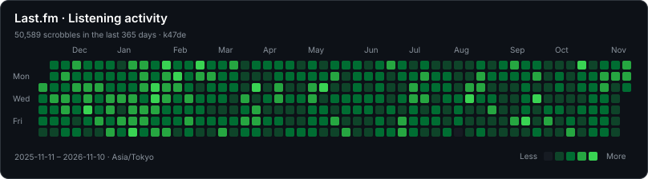

# Last.fm stats

Last.fm SVG cards, updated every six hours by GitHub Actions.

## Listening calendar

After the first successful update, embed the calendar in any GitHub README:

```markdown

```

The calendar covers today and the previous 364 calendar days. Each square is
one day; green intensity shows its scrobble count relative to the busiest day.
Unplayed days remain empty. The current day is partial.

The generator uses `user.getRecentTracks`, fetches all pages in a fixed time
window, and excludes the currently playing track. It rebuilds the full range
on the first run and weekly thereafter. Other runs re-fetch an overlapping seven-day
window (including today), so delayed scrobbles and recent edits are reflected.
Older edits are picked up on the next weekly refresh. Large histories take more API
requests (up to 200 scrobbles per page). API failures fail the workflow before
its commit step, preserving the previously published SVGs.

History is fetched in fixed windows of at most seven days. If page counts or
total scrobbles change, or a multipage response contains an empty page, only
that window is retried from page one (up to three attempts). Partial attempts
are discarded. Persistently inconsistent responses still fail the run.

## Configuration

Set repository Actions secrets `LASTFM_API_KEY` and `LASTFM_USERNAME`.
The existing update workflow generates all four cards with `npm run generate`.
Run it manually with **Actions → Update Last.fm Stats → Run workflow**.
Scheduled workflows run from the default branch and may be delayed by GitHub.

| Environment variable | Default | Meaning |
| --- | --- | --- |
| `LASTFM_TIMEZONE` | `Asia/Tokyo` | IANA timezone used to group scrobbles by day |
| `LASTFM_THEME` | `dark` | `dark`, `light`, or `transparent` |
| `LASTFM_PERIOD` | `7day` | Period for the existing top-track and top-artist cards |

The calendar always covers 365 days, independently of `LASTFM_PERIOD`.
No additional API key or dependencies are needed.

## Development

```sh
npm ci
npm test
npx tsc --noEmit
npm run generate
```

API reference: https://www.last.fm/api/show/user.getRecentTracks

## Build cache

Images and exact-match Deezer artist lookups are cached for seven days in
`.cache/lastfm.json`, persisted between Actions runs with `actions/cache`.
Deezer uses its small image for the 40px portrait; SVGs still embed the image
bytes so README rendering does not depend on external image requests.
Concurrent requests for the same image are deduplicated. Failed downloads are
not cached, and image requests time out after 15 seconds.

A missing or invalid cache triggers a fresh download. History is separated by
username and timezone. Delete the Actions cache (or local `.cache/`) to force
a full refresh. Cached data contains images and daily counts, not API keys.
